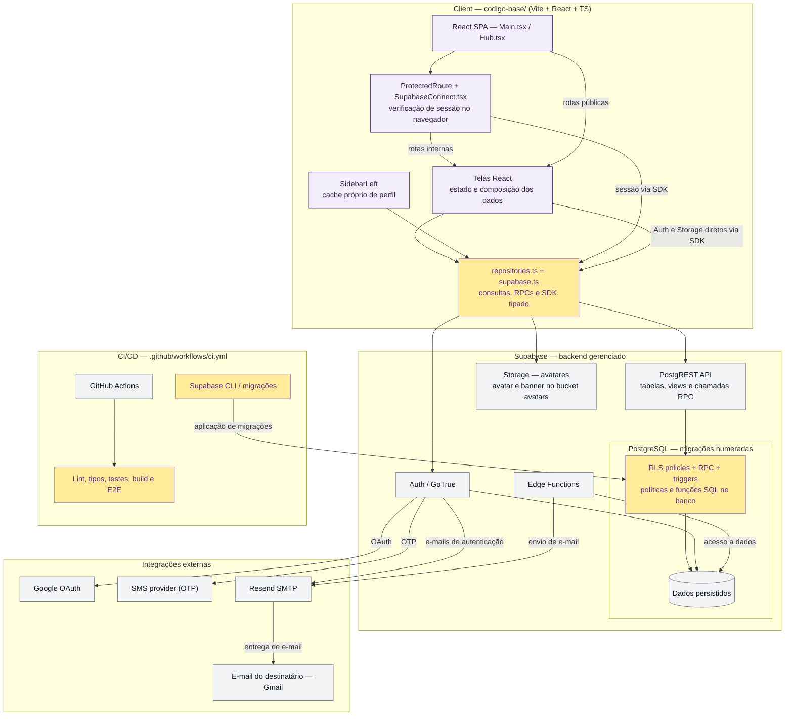

# Athen

Plataforma colaborativa de aprendizagem gamificada, desenvolvida na UC de Engenharia de Software. Reúne cursos, aulas com questões, salas de aprendizagem, recursos sociais e cadernos de anotações.

## Começar

- **Agentes de desenvolvimento:** leia [AGENTS.md](AGENTS.md).
- **Executar a aplicação:** siga o [README de codigo-base](codigo-base/README.md).
- **Encontrar documentação:** consulte o [índice por tarefa](docs/README.md).
- **Entender o produto:** consulte a [visão do projeto](docs/definicao-do-projeto.md) e o [glossário](GLOSSARY.md).

## Estrutura

| Caminho | Conteúdo |
| --- | --- |
| `codigo-base/` | Aplicação React/TypeScript, configurações, testes e SQL do Supabase |
| `docs/` | Referências atuais, regras de desenvolvimento e material histórico identificado |
| `.agents/skills/` | Skills versionadas, compartilhadas por todas as ferramentas |
| `scripts/` | Configuração dos links de compatibilidade das skills |

A [arquitetura atual](docs/arquitetura.md) explica como o cliente web acessa o Supabase. Dependências e comandos executáveis ficam em [package.json](codigo-base/package.json); a instalação reproduzível usa o lockfile da aplicação.

## Diagrama de arquitetura

O diagrama abaixo reproduz a [fonte Mermaid atual](docs/diagramas/arquitetura-atual.mmd). Ao atualizar essa fonte, atualize também este bloco. Consulte a [documentação de arquitetura](docs/arquitetura.md) para os detalhes.

