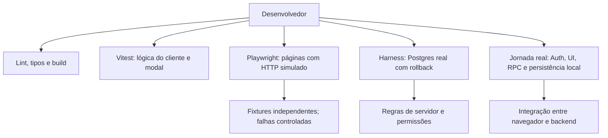
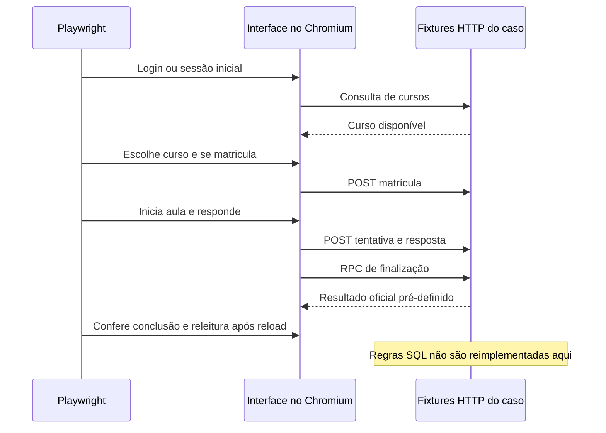
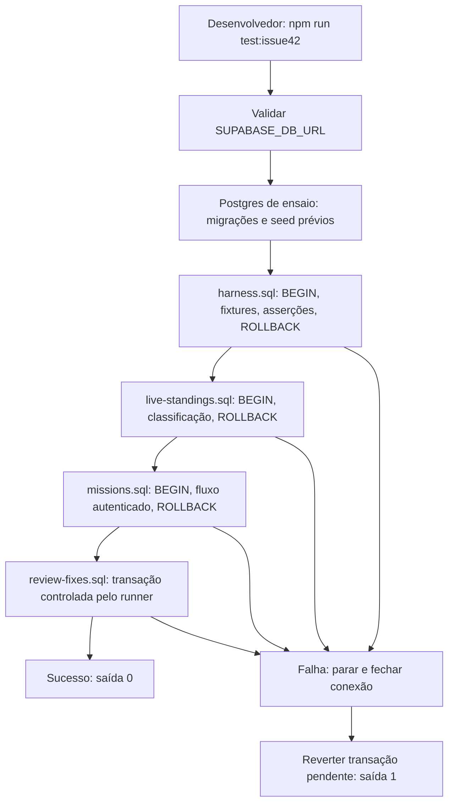
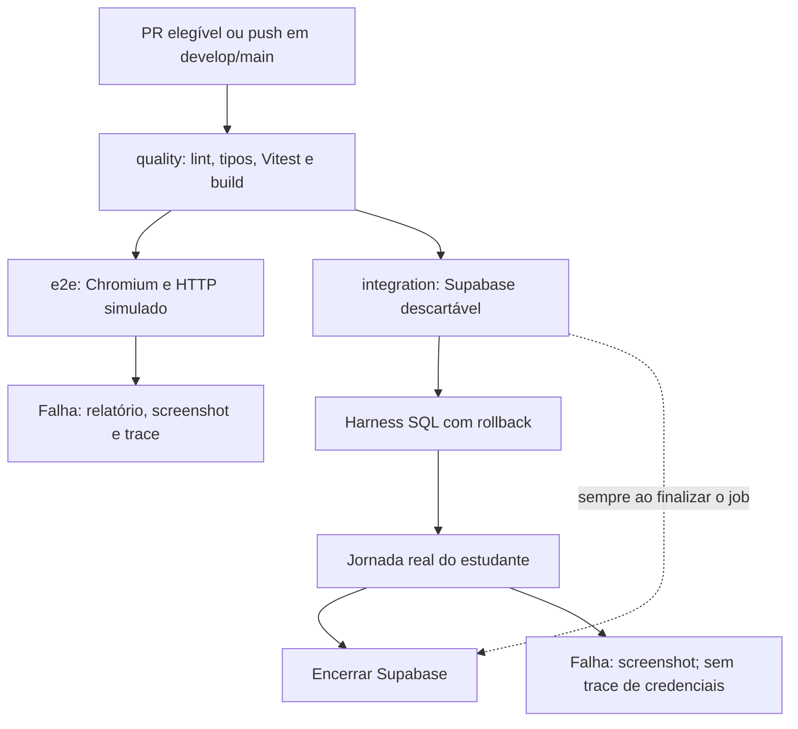

# Mapa dos testes e validações do Athen

> **Referência atual da branch `test/updates`, em 2026-11-09.** Catálogo conferido com os testes e configurações desta atualização. Resultados de execução estão na seção 6; configuração de CI não equivale a uma execução remota aprovada.

Este documento detalha [o guia de execução](testes.md) e complementa o [plano da issue 42](testes-issue-42.md). As seções 2 e 3 descrevem o trabalho local dos desenvolvedores; a seção 4 separa o que roda automaticamente no GitHub Actions e o que está configurado na Vercel.

## 1. Decisões sobre utilidade e cobertura

| Decisão | Motivo |
| --- | --- |
| Remover soma e contador de exemplo, incluindo seus helpers exclusivos | Não exercitavam código do produto. Foram substituídos por validação de conteúdo, calendário das missões e comportamento do modal real. |
| Manter as regressões do dashboard e das ligas | Protegem aula vazia, tratamento de falhas, navegação, layout, atualização de classificação e apresentação das projeções. |
| Reescrever os testes de missões | Agora comparam meta, progresso, recompensa, horário BRT e navegação efetiva, além de estados vazios e erros. |
| Criar fixtures HTTP compartilhadas | Reduzir preparação repetida nas novas suítes, mantendo dados por teste e explicitando endpoints desconhecidos. Não reproduzem RLS ou algoritmos de XP. |
| Acrescentar jornada simulada e jornada real separadas | A primeira permite falhas determinísticas; a segunda integra Auth, PostgREST, RPCs e persistência do Supabase local. |
| Fazer `test:db` executar o harness atual | Evitar que o nome genérico aponte para um menu legado incompatível com o esquema atual. O menu permanece em `test:db:legacy` para consulta histórica. |
| Automatizar `review-fixes.sql` com rollback no runner | As regressões de permissões, virada e aula vazia precisam rodar junto das demais regras de banco. Os ensaios de upgrade continuam separados, pois precisam aplicar uma migração entre fixture e checagem. |

Fontes: [manifesto](../codigo-base/package.json), [Vitest](../codigo-base/vitest.config.ts), [Playwright simulado](../codigo-base/playwright.config.ts), [Playwright real](../codigo-base/playwright.live.config.ts), [runner SQL](../codigo-base/supabase/testes-issue-42/run-harness.ts).

### Inventário e correspondência com as páginas

Há **26 casos Vitest em três arquivos**, **70 casos Playwright simulados em oito arquivos** e **uma jornada real** em arquivo separado. As 16 rotas ativas de [Hub.tsx](../codigo-base/src/Hub.tsx) têm cenário associado; isso não significa cobertura de todas as combinações e operações de cada página. A rota comentada de ranking não foi tratada como funcionalidade disponível.

| Página/rota | Testes úteis existentes nesta atualização |
| --- | --- |
| `/` | Título/cabeçalho, ação de cadastro e entrada pela Home na jornada. |
| `/login-page` | Login recusado, reenvio, exibição de senha, login válido e sessão após reload; login real na jornada local. |
| `/register-page` | Cadastro com papel/nome, erro preservando formulário e link para login; criação real de conta local. |
| `/dashboard` | 11 regressões anteriores, respostas nos quatro formatos, tratamento de erro de gravação, progresso e jornada real. |
| `/catalogo` | Busca sem acentos, filtro por categoria, Meus cursos, falha de leitura, detalhe/matrícula e abertura da trilha. |
| `/salas` | Entrada por código, apresentação da sala retornada e erro preservando código; trilha da sala pelo dashboard. |
| `/profile` | Alteração de nome/bio, requisição de atualização e leitura após reload. |
| `/configuracoes` | Preferências, gravação do nome, persistência e rejeição de confirmação de senha divergente antes de gravar. |
| `/amigos` | Busca, envio de pedido e aceitação de pedido recebido, com atualização da lista. |
| `/notificacoes` | Caixa vazia, erro de consulta, marcação como lida e navegação para o recurso relacionado. |
| `/caderno` | Criação de notebook/página, gravação, conteúdo após reload e confirmação antes de descartar alterações. |
| `/criar-curso` | Validação de dados obrigatórios e persistência de curso/módulo/aula como rascunho. |
| `/ligas` | 13 cenários anteriores de classificação, privacidade visual, atualização, zonas, ausência de inscrição e larguras. |
| `/missoes` | Lista, contexto, meta, progresso, recompensa, navegação e falha de RPC; missão concluída nas jornadas. |
| `/missoes/:id` | Detalhe, prazo BRT, recompensa, meta, conteúdo elegível, indisponibilidade e falha de RPC. |
| `/crud` | Troca entre entidades e leitura de registros da sessão. Não presume autorização administrativa: a rota atual só exige sessão. |

[auth.spec.ts](../codigo-base/tests/e2e/auth.spec.ts) também verifica o redirecionamento de visitantes nas **13 rotas privadas**, inclusive detalhe de missão.



## 2. Execução local pelos desenvolvedores

Todos os comandos partem de `codigo-base/`, com dependências instaladas (`npm ci`). O [guia geral](testes.md) define a sequência completa.

### 2.1. Verificações antes de enviar código

| Comando | Funcionamento | Quando e por que |
| --- | --- | --- |
| `npm run lint` | Executa o [ESLint](../codigo-base/eslint.config.js), com regras TypeScript/React e nomenclatura. Tipos gerados do banco são ignorados; algumas regras geram avisos. | Em toda mudança de código, para identificar problemas estáticos e padrões automatizados. |
| `npm run typecheck` | `tsc -b` verifica os projetos da aplicação e configuração Vite. | Detectar contratos de tipos incompatíveis; não confirma o schema remoto. |
| `npm run test:run` | Executa os testes Vitest uma vez. `npm test` oferece acompanhamento durante desenvolvimento. | Retorno rápido sobre regras do cliente e interação do modal. |
| `npm run test:check` | Compila `src`, `tests`, Vitest e ambas as configurações Playwright sem emitir código. | Tipar os próprios testes e sua infraestrutura. |
| `npm run build` | Compila TypeScript e gera os assets Vite em `dist/`. | Verificar compilação para entrega. Não substitui testes funcionais. |
| `npm run test:e2e` | Executa os 70 cenários simulados em Chromium. | Mudanças nas páginas, navegação ou contratos consumidos pelo cliente. |
| `npm run test:db` | Executa os quatro ensaios atuais de Postgres descritos na seção 3. | Mudanças de regras SQL, XP, missões, temporadas ou permissões. |
| `npm run test:e2e:live` | Executa a jornada de estudante contra Supabase **local real**. | Validar integração completa, principalmente alterações de Auth, matrícula e conclusão. |

O [pre-commit](../codigo-base/.husky/pre-commit) executa apenas `lint-staged`, com `eslint --fix` nos arquivos JS/TS staged. Não executa toda essa sequência nem verifica Markdown.

### 2.2. Vitest: 26 testes de código do produto

A [configuração](../codigo-base/vitest.config.ts) seleciona `tests/**/*.test.{ts,tsx}`, exclui E2E e usa jsdom. O [setup](../codigo-base/tests/setup.ts) instala matchers de DOM e limpa o DOM após cada caso.

| Fonte e casos | Como funcionam | Motivo |
| --- | --- | --- |
| [question-config.test.ts](../codigo-base/tests/unit/question-config.test.ts): 13 | Três slugs conhecidos; XP padrão e modelo incompleto dos quatro tipos; quatro configurações completas; bloqueio de múltipla escolha sem alternativa correta; somatório 1 + 4 = 5, ignorando afirmativa falsa. | Proteger a criação de conteúdo no editor. Não executa a correção SQL das respostas. |
| [missoes-labels.test.ts](../codigo-base/tests/unit/missoes-labels.test.ts): 9 | Distingue contexto global/curso; verifica sete fronteiras de prazo com relógio explícito; confere data/hora BRT e entrada inválida. | Evitar rótulos confusos e prazos dependentes do fuso do desenvolvedor. |
| [Modal.test.tsx](../codigo-base/tests/components/Modal.test.tsx): 4 | Abre o Modal real; verifica fechar pelo fundo, foco inicial/ciclo Tab e Shift+Tab, Escape com restauração de foco e clique no conteúdo sem fechamento. | Proteger interação de teclado e fechamento. Não é auditoria geral de acessibilidade. |

Para focar um arquivo: `npm run test:run -- tests/unit/question-config.test.ts`.

### 2.3. Playwright com HTTP simulado: 70 cenários

O [runner](../codigo-base/playwright.config.ts) gera um build com Supabase fictício, inicia preview próprio em `127.0.0.1:4173` e **recusa reuso implícito de outro servidor**. Roda em dois workers, Chromium, locale pt-BR e fuso America/Sao_Paulo. Guarda screenshot e trace em falhas; o relatório HTML padrão não abre automaticamente. Na CI proíbe `test.only` e permite duas repetições; localmente não repete falhas.

As [fixtures compartilhadas](../codigo-base/tests/e2e/support/platform.ts) simulam a fronteira HTTP de Auth, tabelas e RPCs com `page.route`. Cada teste recebe dados próprios, mantidos entre navegações/reloads daquele caso. Gravações alteram essas fixtures para permitir verificar o consumo posterior pela UI. Endpoints desconhecidos retornam erro e são verificados na finalização da fixture. A animação infinita decorativa do nó ativo é desabilitada na preparação, permitindo cliques estáveis.

Isso não é uma implementação de banco: as fixtures não aplicam RLS, correção de questões ou algoritmos de XP. Os testes anteriores de dashboard/ligas mantêm seus cenários HTTP especializados. Screenshot de sucesso dessas suítes é evidência de inspeção; não há comparação com baseline de imagem.

| Arquivo | Casos e funcionamento | Razão para manter |
| --- | --- | --- |
| [auth.spec.ts](../codigo-base/tests/e2e/auth.spec.ts), 17 | Visitante nas 13 rotas privadas; login inválido com nova tentativa habilitada; payload de cadastro e retorno ao login; cadastro recusado sem perda dos dados; login válido e sessão após reload. | Proteger a entrada e a fronteira entre páginas públicas e privadas. |
| [home-page.spec.ts](../codigo-base/tests/e2e/home-page.spec.ts), 2 | Título/cabeçalho e ação Começar grátis levando ao cadastro, com HTTP controlado. | Detectar quebra da entrada pública e da aquisição de usuário. |
| [dashboard.spec.ts](../codigo-base/tests/e2e/dashboard.spec.ts), 11 | Ausência de matrícula/sala; trilha pela sala; conclusão vazia chamando RPC correta sem tentativa; falha na leitura de questões e na conclusão; consultas TopDown; carrossel com 2/3 módulos; geometria em 1280/1440/1920px. | Preservar regressões de navegação, progresso, contratos e layout. O TopDown ainda não cobre toda mistura/ordenação de missões. |
| [lesson-answers.spec.ts](../codigo-base/tests/e2e/lesson-answers.spec.ts), 5 | Envia os formatos de múltipla escolha, lacuna, somatório e associação; exige resposta antes de Verificar; finaliza mesmo sem feedback imediato e exibe XP oficial; erro de gravação permite reenviar sem iniciar outra tentativa. | Proteger o contrato de respostas e separar feedback opcional da finalização oficial. |
| [ligas.spec.ts](../codigo-base/tests/e2e/ligas.spec.ts), 13 | Temporada/grupo e seis faixas; identidade oculta; ausência de temporada; polling de 60s; falha preservando dados; visibilidade da aba; projeção/zona/avatar/contorno/ordem e queda de zeros na janela final; Bronze pequeno; ausência de inscrição; entrada legada; overflow em 360/768/1440px. | Proteger a apresentação do resultado recebido. Cálculos e privacidade real são verificados no SQL. O caso U2 afirma nome anônimo e XP, sem asserção direta da posição; larguras medem overflow, não toda sobreposição. |
| [missoes.spec.ts](../codigo-base/tests/e2e/missoes.spec.ts), 7 | Lista compara meta, progresso e bônus; detalhe compara valores e conversão BRT, com navegação ao catálogo; indisponibilidade; ordem dos links e clique de navegação; lista vazia; erros das RPCs de lista/detalhe sem falso vazio. | Transformar nomes de testes em verificações efetivas e distinguir indisponibilidade de falha. |
| [platform-pages.spec.ts](../codigo-base/tests/e2e/platform-pages.spec.ts), 14 | Dois cenários de catálogo; dois de salas; edição de perfil; dois de configurações; dois de amizades; dois de notificações; caderno; criação de curso; console CRUD, conforme a matriz da seção 1. | Exercitar ações observáveis nas páginas anteriormente sem cobertura. Persistência aqui significa releitura da fixture, não gravação em Postgres. |
| [study-journey.spec.ts](../codigo-base/tests/e2e/study-journey.spec.ts), 1 | Home → login → catálogo → matrícula → dashboard → resposta/finalização → progresso após reload → missão concluída/detalhe → logout → bloqueio de página privada. Confere os payloads principais e remove a sessão. | Proteger a continuidade da jornada entre páginas, mantendo controle sobre as respostas HTTP. Logout aceita Home ou login como destino público, pois a proteção de rota também reage a SIGNED_OUT. |

Para executar uma área: `npm run test:e2e -- tests/e2e/platform-pages.spec.ts`. Para inspecionar descoberta sem executar: `npm run test:e2e -- --list`.



### 2.4. Jornada com Supabase local real

A [configuração separada](../codigo-base/playwright.live.config.ts) executa apenas [local-study.spec.ts](../codigo-base/tests/live/local-study.spec.ts), em um worker e sem retries. Exige Docker e a pilha local criada com as migrações numeradas e o seed. Para iniciar os serviços mínimos usados pelos testes:

```bash
npx supabase start -x studio,imgproxy,storage-api,realtime,edge-runtime,logflare,vector,supavisor,postgres-meta,mailpit
npm run test:e2e:live
```

O [leitor do ambiente local](../codigo-base/tests/live/local-supabase.ts) consome `supabase status -o json` sem imprimir chaves. Recusa API que não seja `localhost`/`127.0.0.1`; não lê `.env` nem recebe URL remota. O build do teste usa a URL/chave anônima local em memória e preview próprio na porta 4175. As suítes simulada e real devem rodar **sequencialmente**, pois ambas geram `dist/`.

O cenário cria uma conta aleatória pelo cadastro real, entra pelo formulário, matricula-se no curso do seed **Lógica de Programação**, responde **O que é lógica**, verifica 4 XP oficiais e progresso do módulo de 33% após reload, consulta missões concluídas e sai. Não usa `page.route`, sessão injetada ou resultados falsos. Sem Docker/backend, falha na preparação com instrução explícita; não se declara aprovado por skip.

Por se tratar de banco local descartável, a conta e a atividade de cada execução ficam disponíveis para diagnóstico, sem limpar usuários preexistentes. O teste desliga traces para não registrar credenciais de login; screenshots de falha permanecem em `test-results/live/`. O teste não envia e-mails externos, não cobre OAuth, Storage, cron ou entrega de webhook.

## 3. Banco de dados e ensaios locais

Esta seção descreve as fontes SQL versionadas, conferidas por leitura em 2026-11-09. Não constitui registro de execução dos ensaios. O plano funcional complementar está em [Testes da issue 42](testes-issue-42.md); as afirmações abaixo distinguem os cenários planejados das asserções efetivamente implementadas.

### Harness atual: execução, ambiente e isolamento

O comando `npm run test:db` (alias de `npm run test:issue42`), a partir de `codigo-base/`, chama [run-harness.ts](../codigo-base/supabase/testes-issue-42/run-harness.ts). O runner usa `pg` para conectar ao Postgres indicado em `SUPABASE_DB_URL` e executa, nesta ordem, [harness.sql](../codigo-base/supabase/testes-issue-42/harness.sql), [live-standings.sql](../codigo-base/supabase/testes-issue-42/live-standings.sql), [missions.sql](../codigo-base/supabase/testes-issue-42/missions.sql) e [review-fixes.sql](../codigo-base/supabase/testes-issue-42/review-fixes.sql). Resolve os arquivos a partir do próprio módulo; não depende do diretório de trabalho para encontrá-los. Não carrega `.env` por conta própria, não cria um banco nem aplica migrações.

O alvo deve ser um banco de ensaio com migrações até `0041` e [seed base](../codigo-base/supabase/seed.sql). O cabeçalho de `harness.sql` ainda menciona até `0040`, mas o runner completo inclui a suíte de classificação da `0041`. Em PowerShell, depois de fornecer a conexão de ensaio ao ambiente da sessão:

```powershell
cd codigo-base
npm run test:issue42
```

Execute ao alterar XP, finalização de aula, missões, temporadas, funções SQL ou permissões e antes de integrar essas mudanças. Localmente são comandos explícitos; o job `integration` do GitHub Actions também os executa. A suíte exige privilégios de montagem de fixtures; somente parte dos casos troca explicitamente para `role authenticated` para verificar acesso do estudante.

Os três primeiros arquivos contêm `BEGIN`/`ROLLBACK`; para `review-fixes.sql`, o runner abre a transação e garante o rollback em `finally`. O runner habilita `plpgsql.check_asserts`, limita a conexão a 10 segundos e cada query a 60 segundos. `assert` causa erro se uma expectativa não for atendida. A primeira falha interrompe a sequência, gera código de saída 1 e fecha a conexão, revertendo uma transação pendente. A ausência de `SUPABASE_DB_URL` ou a identificação do projeto de produção conhecido na URL gera saída 2. A trava confere um identificador específico: ela não comprova que qualquer outra URL é um ambiente de ensaio. O sucesso completo imprime `HARNESS ISSUE 42: OK (todas as assercoes passaram; rollback aplicado)`.



O rollback protege a persistência do ensaio, mas não transforma o alvo em banco isolado. `harness.sql` limpa temporariamente tabelas inteiras de temporadas, eventos e missões; isso pode bloquear ou interferir com outras sessões durante a transação. `missions.sql` monta fixtures próprias com UUIDs aleatórios sem limpar dados existentes. Use ambiente dedicado para tornar os resultados interpretáveis.

### XP, conclusão, temporadas e alertas: `harness.sql`

O arquivo reutiliza Carla, Diego, Elisa, Felipe e as aulas do seed base. Insere respostas e chama funções SQL reais, em vez de reproduzir a regra em memória. Os identificadores T abaixo são os presentes no código; a sequência não implementa integralmente todos os casos T1–T9 do plano.

| Caso implementado | Como funciona e o que verifica | Motivo |
| --- | --- | --- |
| T1.1a/T1.1b — XP após erro | Finaliza uma resposta errada, esperando 0 XP, e uma correta na segunda execução, esperando `round(4/2) = 2`. | Evitar crédito por erro e regressões no XP proporcional ao primeiro acerto. |
| T1.2 — primeiro acerto | Finaliza uma questão de preencher lacuna acertada de primeira e exige 6 XP. | Preservar o valor cheio na primeira execução correta. |
| T1.3 — repetição após acerto | Cria outra tentativa correta da mesma questão e exige 0 XP. | Impedir ganho repetido por conteúdo já acertado. |
| T10 — finalização em sala | Finaliza tentativa vinculada a sala, exige XP não negativo e permanência da associação do estudante à sala. A chamada deve completar sem exceção. | Regressão do trigger que acessava `updated_at` inexistente em `room_members`. Não compara saldos interno e global. |
| T2.1 — existência de ledger | Exige pelo menos um evento `learning_base/course` da Carla após as finalizações. | Confirmar integração entre finalização e ledger. A asserção não exige um evento para cada tentativa. |
| T2.3 — finalização idempotente | Conta eventos, refinaliza a tentativa vencedora e exige a mesma contagem. | Evitar duplicação de eventos ao repetir uma requisição. |
| T3.1 — materialização de missão | Exige pelo menos uma atribuição global diária da Carla após as atividades. | Detectar interrupção da integração entre atividade e missão. |
| T5.1a/T5.1b — grupo pequeno | Cria temporada vencida em Prata, Elisa com evento real de 90 XP e Felipe zerado; fecha e exige permanência em Prata e queda para Bronze, respectivamente. | Garantir a regra de grupo pequeno e queda do participante sem XP. |
| T5.1c/T5.1d — consolidação | Após fechar, exige saldos consolidados 90 e 0 nas entradas. | Garantir que o fechamento usa eventos da janela da temporada. |
| T5.3 — fechamento idempotente | Fecha novamente e exige que o resultado de Felipe continue Bronze. | Evitar nova movimentação ao repetir o fechamento. |
| T6.2a/T6.2b/T6.2c — identidade oculta | Cria temporada aberta, marca Elisa como oculta e lê `my_season_group` com seu JWT; exige `hidden=true`, nome nulo e 50 XP provenientes do ledger. | Preservar a pontuação enquanto protege a identidade. A montagem usa privilégio de ensaio; não testa o fluxo de desativação de conta. |
| T9.1a/T9.1b/T9.1c — alerta deduplicado | Cria temporada vencida há 45 minutos, chama `check_season_alerts(30)` duas vezes; exige novos alertas na primeira chamada, zero na segunda e evento `alert` para a temporada. | Detectar atraso e impedir registro duplicado. Não confirma entrega externa do webhook. |

O trecho de bônus sob T3 apenas executa `PERFORM` sobre eventos `mission_bonus`, sem exigir resultado nem afirmar exclusão de bônus da classificação. A cobertura efetiva de bônus, progresso e RLS está em `missions.sql` e `live-standings.sql`. O arquivo não ensaia diretamente formação social por BFS, distribuição por capacidade, ciclo de desativação, cálculo de PAC/cobertura, existência do job `pg_cron` ou entrega do alerta. Os comentários T4/T5 e T8/T9 não equivalem a cobertura integral dessas áreas.

### Classificação ao vivo: `live-standings.sql`

Esse arquivo monta 14 usuários e dois grupos; o principal tem 12 participantes com pontuações `100, 90, 90, 70, 60, 50, 40, 30, 20, 10, 0, 0`. Cria eventos reais de XP, injeta bônus de missão e XP de sala e compara projeção com o fechamento real. Roda na sequência do harness, sempre com rollback.

| Verificação implementada | Como funciona | Motivo |
| --- | --- | --- |
| Entrada inicial e tardia | Usa datas de criação da temporada e conclusões anteriores para exigir `snapshot` ou `late`; cobre também retorno após a abertura. | Preservar o significado da inscrição e da elegibilidade. |
| Escopo do próprio grupo | Com `role authenticated`, exige 12 linhas em `my_season_standings` e nenhuma linha para uma temporada aleatória sem participação. | Impedir exposição de classificação de grupo alheio pela RPC. |
| Sessão obrigatória | Verifica ausência de `EXECUTE` para `anon` em `my_season_standings(uuid)`. | Evitar leitura anônima da classificação. |
| Fonte de XP competitivo | Injeta 9999 de bônus e 9999 de sala, mas exige 100 no resumo do participante. | Impedir contaminação do XP competitivo por outras fontes. |
| Identidade oculta | Exige nome, avatar e banner nulos na linha oculta. | Evitar vazamento de identidade pelos campos visuais. |
| Cortes e empate | Exige três promovidos devido ao empate na fronteira e quatro rebaixados, incluindo dois zerados. | Garantir tratamento conjunto de empates e queda dos zeros. |
| Projeção versus fechamento | Guarda a leitura projetada, executa `close_season` e compara cada `result_category` com `projected_category`. | Assegurar que a promessa apresentada pela classificação corresponde à apuração. |
| Resultado congelado | Insere novo evento depois de fechar e exige que o resumo continue com 100 XP consolidados. | Impedir alteração retroativa da temporada fechada. |
| Grupo pequeno e piso | No outro grupo, exige permanência de zero no Bronze e de participante positivo em grupo pequeno. | Evitar rebaixamento abaixo do Bronze ou promoção sem mínimo de participantes positivos. |
| Teto Mestre | Muda o grupo para Mestre e exige projeção ainda em Mestre. | Evitar categoria acima do teto. |

O plano em [Testes da issue 42](testes-issue-42.md) ainda cita o corte em grupo grande como complementar/manual; esta suíte já cobre um grupo com dez positivos, empate na promoção e comparação com fechamento. Isso não significa cobertura de toda combinação possível de empates ou distribuição de grupos.

### Missões e segurança do fluxo: `missions.sql`

Monta dois estudantes, curso, módulo, aula com questão de 10 XP, aula vazia e duas definições próprias de missão (uma aula por 7 XP e duas aulas por 11 XP). A preparação usa privilégio de ensaio; as ações dos estudantes usam `role authenticated`, JWT e políticas reais. Roda em `test:issue42` após a classificação.

| Caso | Como funciona e o que verifica | Motivo |
| --- | --- | --- |
| M1 — períodos | `ensure_occurrence` deve retornar a mesma ocorrência no mesmo dia e outra no dia seguinte; ao fim, exige ausência de progresso e atribuição no período futuro. | Impedir duplicação por período ou vazamento temporal de atividade. |
| M2 — avanço público | Cria tentativa e resposta como estudante, finaliza pela RPC e lê `my_missions` e `my_mission_detail`; exige missão de uma aula concluída a 100% e missão de duas aulas a 50%. | Garantir que o fluxo usado pela aplicação atualiza lista e detalhe de missões. |
| M3 — bônus | Exige um único evento de bônus com chave da atribuição e valor 7; XP competitivo deve ficar em 10 e saldo global deve igualar a soma de eventos de curso. | Distinguir recompensa de missão, saldo global e competição, mantendo consistência do ledger. |
| M4 — repetição | Refinaliza a mesma tentativa e compara contagem de eventos, saldo global e data da conquista. | Evitar crédito duplicado e alteração da data em reenvios. |
| M5 — aula sem questões | Chama `complete_empty_lesson`, exige segunda missão concluída a 100% e competição ainda com 10 XP; repete e compara eventos e saldo. | Aula vazia deve contar para conclusão, sem criar XP base ou duplicar recompensas. |
| M6 — isolamento | Troca para o segundo estudante; exige ausência de atribuições do primeiro sob RLS, detalhe com progresso próprio zerado e erro de privilégio ao finalizar tentativa alheia. Também exige ausência de `EXECUTE` na função interna de concessão para `authenticated`. | Proteger progresso e impedir fabricação de XP ou ação sobre tentativa alheia. |

### Permissões e virada: `review-fixes.sql`

O quarto ensaio agora roda automaticamente no harness. Verifica bloqueio das funções internas de crédito e virada para os papéis indevidos; fechamento da semana anterior antes da abertura da atual com categoria herdada; inscrição por primeira atividade; e aula vazia avançando missão sem XP base. Usa contas do seed e limpa tabelas de temporada dentro da transação revertida pelo runner. Sua inclusão evita depender de execução manual dessas regressões; não substitui os ensaios de migração abaixo.

### Ensaios SQL complementares: execução manual

Os três arquivos de upgrade seguintes existem, mas não integram `npm run test:db`. Roda-se seu SQL explicitamente em uma conexão de ensaio, conforme a etapa indicada. Eles não abrem nem revertem a transação por conta própria: o operador precisa usar `BEGIN` e encerrar com `ROLLBACK`, mantendo fixture, migração e checagem na mesma sessão quando exigido. Não devem ser executados automaticamente como se fossem migrações da aplicação.

| Arquivo | Como e quando executar | Cobertura e motivo |
| --- | --- | --- |
| [legacy-upgrade-fixture.sql](../codigo-base/supabase/testes-issue-42/legacy-upgrade-fixture.sql) | Antes da `0040`, na mesma transação da migração e da checagem; requer ausência das tabelas legadas que cria. | Prepara tabelas antigas `xp_credits`/`league_*`, um crédito de 17 XP e temporada encerrada; é preparação, sem asserções. Permite testar a preservação de dados no upgrade. |
| [legacy-upgrade-check.sql](../codigo-base/supabase/testes-issue-42/legacy-upgrade-check.sql) | Depois da fixture e da `0040`, antes do rollback. | Exige cópia do crédito como `learning_base/course` com chave legada e preservação de XP 17, posição 1, categoria Ouro e resultado Platina. |
| [legacy-overlap-check.sql](../codigo-base/supabase/testes-issue-42/legacy-overlap-check.sql) | Antes da `0040`, criar `review_entries_before` como fotografia de `public.season_entries`; aplicar a migração e checar na mesma transação. Exige tabelas `league_entries` e `league_seasons` do cenário legado. | Exige que entradas existentes mantenham ID, grupo, categoria, XP e resultado; que cada participante legado encontre correspondência por semana/usuário; e que a função interna de crédito permaneça sem `EXECUTE` para estudante. Detecta perdas na coexistência de IDs antigos e novos. |

### Cenário persistido para inspeção: `seed_teste.sql`

[seed_teste.sql](../codigo-base/supabase/testes-issue-42/seed_teste.sql) prepara uma demonstração determinística usando o seed base: Carla erra e depois acerta, Diego acerta de primeira, cria temporada corrente, temporada vencida com evento real de 120 XP e temporada atrasada para alerta, além de conclusões para elegibilidade. Pode apoiar inspeção manual de servidor/UI e o roteiro de [Testes da issue 42](testes-issue-42.md). Não é teste auto-verificável e não faz parte do runner.

Ao contrário dos ensaios do harness, não envolve todo o cenário em transação revertida. Sua limpeza apaga todos os eventos de XP, atribuições/ocorrências de missão, entradas/grupos/temporadas e parte das atividades das contas de teste; o comentário de que só remove dados do cenário não corresponde ao alcance desses `DELETE`. Use apenas banco descartável de ensaio. A temporada corrente recebe `season_xp` plantado; após a `0041`, leituras ao vivo usam o ledger, portanto esses saldos artificiais não comprovam a classificação exibida. O agendador real também pode fechar a temporada atrasada antes da inspeção.

A entrega real do webhook e o funcionamento efetivo de `pg_cron` exigem verificação do ambiente. O ensaio de alerta deduplicado não prova chegada de mensagem ao destino. O plano da issue 42 traz passos manuais para entrega; qualquer configuração de Vault/`pg_net` e observação no destino é distinta das asserções locais. Testes de UI com RPCs simuladas tampouco provam esses serviços.

### Suíte CRUD legada: `test:db:legacy`

[run-testes.ts](../codigo-base/supabase/testes/run-testes.ts), chamado por `npm run test:db:legacy`, abre menu interativo, lê `SUPABASE_DB_URL` do processo e executa os SQL via `pg` com SSL e `rejectUnauthorized: false`. Os scripts usam o modelo antigo com nomes como `public."Usuario"`, `"Curso"` e `"matricula"`, portanto não validam o esquema atual. Cada arquivo faz `BEGIN`/`COMMIT`: os efeitos persistem entre etapas. A ordem é importante porque os UUIDs fixos de criação alimentam leitura, atualização e exclusão.

| Etapa e fonte | O que faz e como verifica | Motivo original |
| --- | --- | --- |
| 1 — [01_create.sql](../codigo-base/supabase/testes/01_create.sql) | Remove usuários com UUIDs fixos, cria dois em Auth e exige sincronização do perfil; insere curso, sala, módulo, aula, questão, matrícula, participação, caderno e anotação. As demais mensagens de sucesso dependem principalmente de os inserts não falharem. | Testar trigger de perfil e integração das entidades antigas. |
| 2 — [02_read.sql](../codigo-base/supabase/testes/02_read.sql) | Exige perfil encontrado, contagem de um estudante e XP inicial 100; consulta participação e anotações e imprime seus valores sem assert específico nesses dois pontos. | Conferir estado derivado e relacionamentos após a criação. |
| 3 — [03_update.sql](../codigo-base/supabase/testes/03_update.sql) | Insere conclusão, exige uma aula finalizada, tenta adulterar XP e exige valor menor que 99999; avalia curso e exige média 5 e contagem 1; tenta reavaliar com tratamento de exceção amplo. | Exercitar triggers de progresso, proteção do saldo e agregação de avaliações. |
| 4 — [04_delete.sql](../codigo-base/supabase/testes/04_delete.sql) | Exclui curso e exige ausência dos módulos, aulas, questões, sala e matrículas; exclui usuários e exige ausência de perfis e anotações vinculadas. | Detectar falhas de exclusão em cascata. |

Limitações concretas que impedem tratar esse menu como um gate confiável:

- O runner procura `./01_create.sql` etc. em relação ao diretório atual. Partindo de `codigo-base/`, como faz o script npm, esses arquivos não estão no caminho esperado.
- O resultado booleano de cada execução é ignorado pelo menu; uma falha não interrompe a opção de executar tudo nem produz falha global confiável.
- A opção 5 executa criação → leitura → atualização → leitura → exclusão. O menu anuncia mais uma leitura final, que não está implementada; a leitura também exige XP inicial 100 mesmo após as atualizações.
- Em `03_update.sql`, `EXCEPTION WHEN OTHERS` captura inclusive o próprio `RAISE EXCEPTION '[FAIL]...'` lançado quando a reavaliação indevida é aceita, produzindo falso sucesso de imutabilidade.
- Há mensagens `[PASS]` sem comparação do resultado esperado. Execução sem erro SQL não equivale a comprovação de toda a regra mencionada.
- Os scripts persistem mudanças e a limpeza usa UUIDs fixos; não há provisionamento de banco isolado nem bloqueio de URL de produção nesse runner.

Esse material serve para entender a intenção histórica de testes CRUD. Atualizar a suíte ou corrigir os runners é mudança de implementação separada deste inventário documental.

## 4. Execução automática: GitHub Actions e Vercel

### 4.1. GitHub Actions

O [workflow ci.yml](../.github/workflows/ci.yml) dispara em PRs cujo **destino** seja `sprint*`, `develop` ou `main`, e em pushes para `develop`/`main`. Push isolado para `test/updates` não dispara esse gatilho. Não há filtro de caminhos, agendamento ou disparo manual declarado. Uma execução nova cancela a anterior do mesmo PR/ref.

Todos os jobs usam Ubuntu, Node 22.12.x, `npm ci` e cache pelo lockfile. Os jobs de navegador dependem da aprovação de `quality`; as instalações/builds pertencem a cada job.

| Job | Sequência automatizada | Motivo e alcance |
| --- | --- | --- |
| `quality` | Lint → tipos da aplicação → 26 casos Vitest → tipos dos testes/configurações → build. | Verificações rápidas antes das suítes de navegador/banco. Não executa o produto no servidor. |
| `e2e` | Instala Chromium/dependências e executa os 70 casos simulados de 2.3. | Verifica páginas e falhas controladas sem depender de dados externos. Em falhas tenta publicar `playwright-report` e `test-results` no artefato `playwright-report`. |
| `integration` | Inicia Supabase local descartável com migrações/seed → `test:db` → instala Chromium → `test:e2e:live` → encerra a pilha mesmo em falha. | Liga as regras SQL e a jornada real à CI, sem credenciais remotas. Publica screenshots de falha em `supabase-integration-results`. Logs de inicialização não são publicados, pois podem conter chaves locais. |

O job de integração usa a conexão Postgres de loopback da configuração local versionada e executa os mesmos comandos ensaiados localmente. O workflow foi revisado nesta entrega; seu resultado no GitHub só pode ser afirmado após um evento elegível. Regras de branch protection também dependem da configuração do GitHub.



### 4.2. Vercel

O [vercel.json](../codigo-base/vercel.json) contém apenas rewrite de rotas para `/index.html`. Não declara execução de testes. Não foi acrescentado deploy Vercel ao workflow.

Se o painel usar `npm run build`, executará tipos/build, sem chamar Vitest, Playwright ou SQL. Eventos de Preview/produção, comandos personalizados, variáveis e vínculo com Git precisam ser conferidos no painel. Esta entrega não inspecionou nem publicou um deploy Vercel; o GitHub Actions é a automação versionada dos testes.

## 5. Limites e manutenção

Cobrir cada rota ativa não significa cobrir todas as funcionalidades. Continuam complementares: OAuth/recuperação de senha e entrega de e-mail; upload e políticas de Storage; exclusão/desativação completa de conta; edição/publicação de todos os tipos de conteúdo; operações completas de sala/CRUD; catálogo com todas as combinações de permissão; TopDown com mistura/ordenação de todas as missões; formação social/capacidade de grupos; PAC/cobertura em todas as janelas; acessibilidade com leitor de tela; navegadores diferentes do Chromium; entrega real de alerta e cron efetivamente agendado.

Não há instrumento/limiar de cobertura de linhas configurado. Os screenshots de sucesso dos testes antigos não são testes de regressão visual por comparação de pixels. As regras de RLS verificadas são aquelas explicitamente exercitadas no SQL e na jornada real, não uma auditoria de todas as políticas.

Ao alterar páginas ou RPCs, atualize o caso que observa seu comportamento e as fixtures afetadas; não aceite endpoint novo silenciosamente. Não use um resultado simulado como evidência de regra SQL. Ao alterar SQL, rode `test:db` e a jornada real em sequência, mantendo o banco isolado. Migrações de upgrade continuam exigindo fixture → migração → checagem em uma única transação revertida.

A [arquitetura](arquitetura.md), as [tecnologias](tecnologias-utilizadas.md) e o [guia de execução](testes.md) apontam para a configuração atual. Consulte o workflow para gatilhos e o manifesto para comandos, evitando tratar fotografias históricas como garantia de ambiente remoto.

## 6. Validação desta atualização

- Estado inicial: quatro testes de exemplo/modal e build aprovados antes das alterações.
- Vitest atualizado: **26 casos aprovados**.
- Jornada real: **um caso aprovado**, com Auth e Postgres locais, sem mocks.
- Harness atualizado: **aprovado**, incluindo `review-fixes.sql`, com asserções habilitadas e rollback.
- **70 cenários E2E simulados aprovados**, em dois workers. Lint, tipos da aplicação e tipos de testes/configurações aprovados. Builds da aplicação e das duas configurações de navegador aprovados. Links, caminhos e diagramação Markdown conferidos; Mermaid revisado como código, sem renderização visual.
- O MCP Playwright abriu o Edge e inspecionou a página inicial; a suíte executável roda em Chromium.
- Não houve execução de CI remota, deploy Vercel ou alteração no banco remoto. O documento preexistente de pendências foi preservado.
